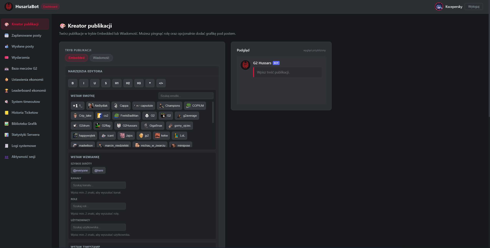
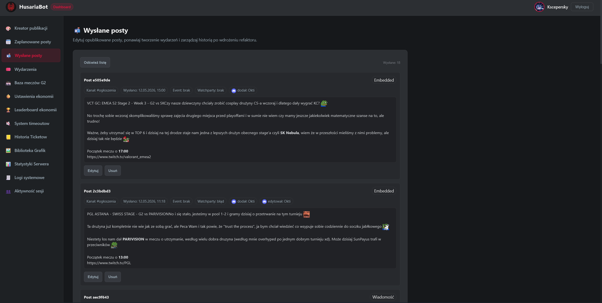
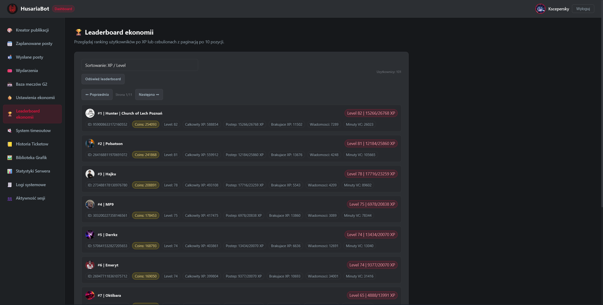

<div align="center">

# HusariaBot

**A production-grade Discord bot for the G2 Hussars community.**  
Built with TypeScript, discord.js v14, and an Express-powered admin dashboard.


</div>

---

## Overview

HusariaBot is a fully self-hosted Discord bot with a built-in web admin dashboard. It covers the complete lifecycle of a community server: engagement through a leveling and coin economy, content publishing via a rich post creator with scheduling, automated voice channel management, a support ticket system, and role-based moderation tools.

Every subsystem is backed by structured JSON logging with per-scope loggers, Discord webhook alerting on critical failures, and a SQLite persistence layer that survives process restarts.

---

## Dashboard preview


---

## Table of Contents

- [Features](#features)
- [Tech Stack](#tech-stack)
- [Prerequisites](#prerequisites)
- [Getting Started](#getting-started)
- [Environment Variables](#environment-variables)
- [Slash Commands](#slash-commands)
- [Dashboard](#dashboard)
- [Project Architecture](#project-architecture)
- [Testing](#testing)
- [Logging](#logging)
- [License](#license)

---

## Features

### Economy System

A fully configurable engagement system tracking XP, levels, and a server currency (Cebuliony).

- **XP & Leveling** — Members earn XP by sending messages (with per-user cooldown) and spending time in voice channels. Two leveling modes (`progressive` exponential, `linear`) and two curve formulas (`default`, `formula_v2`) can be tuned per guild without a redeploy.
- **Cebuliony (coins)** — Server currency awarded on level-up and daily claim, spendable in the shop.
- **Daily Rewards with Streak** — Configurable coin range, streak multiplier, max streak days, and grace window. Streak is preserved if the member claims within the grace period after missing a day.
- **Level Cards** — Canvas-generated image cards showing avatar, level, global rank, and XP progress bar. Rendered and returned as a Discord attachment.
- **Leaderboard** — Paginated ranking by XP or coins with Discord avatars, member display names, and personal rank highlighting.
- **Role Mappings** — Automatic Discord role assignment when a member reaches a configured level threshold. Managed from the dashboard without touching code.
- **Bulk CSV Import** — Import economy snapshots directly: `userId,level,totalxp,messages,voiceMinutes`. Validates each row with clear line-numbered error messages.
- **Staff Protection** — Configurable set of staff roles exempt from specific economy mechanics (e.g. XP exclusion zones).

### Shop

- Members browse items with `/sklep`, buy with `/kup`, and track purchases with `/zamowienia`.
- Each purchase opens a private order ticket; staff complete or cancel the order from the dashboard, and the ticket is closed automatically.
- Items support price, stock, and a per-user purchase limit. Everything is managed from the dashboard Shop section.

### Fun & Games

Light-hearted commands, many of them rendering a Canvas image card in the same style as the level card:

- **`/ship` and `/zeswataj`** — compatibility percentage between two members, with avatars and a progress bar. `/zeswataj` lets you match any two people.
- **`/kula`** — crystal ball: ask a yes/no question and get a short animated "reading" before the answer.
- **`/champion`** — assigns a League of Legends champion to the user. The pick is deterministic (hash of the user ID), so everyone always gets the same champion. The card shows the splash art, icon, title and official lore, loaded from [Data Dragon](https://developer.riotgames.com/docs/lol#data-dragon) (Polish locale, cached for 24 h). A few users have a champion pinned in `src/commands/champion-pick.ts`.
- **`/statylol`** — `/statylol riottag:Nick#TAG [region]` renders a player card with level, Solo/Duo rank and win rate, top 3 mastery champions and the last 5 matches (result, KDA, CS, duration, queue). Data comes from the Riot API (account, summoner, league, champion-mastery and match-v5), results are cached for 5 minutes to stay within key rate limits. Requires `RIOT_API_KEY`.
- **Duels** — `/pkn` (rock-paper-scissors), `/kk` (tic-tac-toe) and `/rr` (Russian roulette) against a chosen member, played with buttons. `/pknranking` and `/kkranking` show win/loss/draw rankings.
- **`/canvastest`** — owner-only preview of every card with sample data; a new card type is a single entry in `src/commands/canvas-previews.ts`.

### Temporary Voice Channels

- Members joining the trigger channel immediately get their own private voice channel in the configured category.
- The channel is deleted automatically when the last member leaves.

### Support Tickets

- Configurable ticket panel published via `/ticketyconfig` — renders an embed with interactive buttons.
- Monotonic ticket counter with persisted state across restarts.
- Full ticket history stored in a JSON file.

### Timeouts (Mute)

- `/mute` command with configurable duration (minutes / hours / days) and a mandatory reason.
- Implemented via a dedicated `SERVER_MUTE_ROLE_ID` role rather than Discord's native timeout, providing more control.
- Auto-release on expiry with SQLite persistence — survives process restarts.
- Full audit log: who muted, who was muted, duration, and reason.

---

## Tech Stack

| Layer | Technology |
|---|---|
| Language | TypeScript 6 |
| Runtime | Node.js 20+ |
| Discord | discord.js v14 |
| Web (dashboard) | Express v5 |
| Database | SQLite via `sqlite` + `sqlite3` |
| Input validation | Zod v4 |
| Image generation | Canvas |
| External data | Riot Data Dragon + Riot API (`/champion`, `/statylol`), PandaScore (G2 matches) |
| Sessions | express-session + SQLite store |
| Rate limiting | express-rate-limit |
| Testing | Vitest |
| Dev runner | tsx |
| Build | tsc |

---

## Prerequisites

- **Node.js** v20 or later
- **npm** v9 or later
- A Discord application registered in the [Discord Developer Portal](https://discord.com/developers/applications) with the following **Privileged Gateway Intents** enabled:
  - `GUILD_MEMBERS`
  - `GUILD_MESSAGES`
  - `MESSAGE_CONTENT`
  - `GUILD_VOICE_STATES`
- *(Optional)* A [PandaScore](https://pandascore.co/) API key for the G2 match history section.

---

## Getting Started

```bash
# 1. Clone the repository
git clone https://github.com/Kscepersky/HusariaBot.git
cd HusariaBot

# 2. Install dependencies
npm install

# 3. Configure environment variables
cp .env.example .env
# Edit .env and fill in all required values (see section below)

# 4. Register slash commands on your server
npm run deploy

# 5. Start the bot and dashboard as separate processes
npm run dev            # bot  — development mode (tsx watch)
npm run dashboard:dev  # dashboard — development mode (tsx watch)
```

**Production:**

```bash
npm run build      # compile TypeScript → dist/
npm start          # start the bot from dist/
npm run dashboard  # start the dashboard from dist/
```

> The bot and the dashboard are two independent Node.js processes. In production, run them as separate service units (e.g. two PM2 instances, two systemd services, or two Docker containers).

---

## Environment Variables

Copy `.env.example` to `.env` and fill in every value:

```env
# ── Discord Bot ──────────────────────────────────────────────────────────────
DISCORD_TOKEN=              # Bot token — Discord Developer Portal → Bot → Token
CLIENT_ID=                  # Application ID — Developer Portal → General Information
GUILD_ID=                   # Your server ID (guild-scoped commands deploy instantly)

# ── Owner ────────────────────────────────────────────────────────────────────
# Discord user ID of the bot owner — right-click yourself → Copy User ID.
# The bot and dashboard refuse to start without a valid ID. Everyone else gets
# access through the dashboard's Permissions tab.
OWNER_ID=

# ── Role IDs ─────────────────────────────────────────────────────────────────
# Right-click a role in Discord → Copy Role ID
SERVER_MUTE_ROLE_ID=        # Role assigned by /mute — must be below bot's highest role

# ── Channel & Category IDs ────────────────────────────────────────────────────
SUPPORT_CATEGORY_ID=           # Category where ticket channels are created
VOICE_TRIGGER_CHANNEL_ID=      # Joining this channel creates a private voice channel
VOICE_CATEGORY_ID=             # Category for temporary private voice channels
LEVEL_UP_ANNOUNCE_CHANNEL_ID=  # Text channel for level-up announcements (optional)

# ── Dashboard OAuth2 ──────────────────────────────────────────────────────────
# Discord Developer Portal → OAuth2 → General
DISCORD_CLIENT_SECRET=
DISCORD_REDIRECT_URI=http://localhost:3000/auth/discord/callback
DASHBOARD_PORT=3000
DASHBOARD_BASE_URL=http://localhost:3000
DASHBOARD_SESSION_SECRET=      # Min 32 random chars — generate: openssl rand -hex 32
DASHBOARD_SESSION_TTL_HOURS=24
DASHBOARD_TRUST_PROXY=0        # Set to 1 if the dashboard is behind a reverse proxy

# ── Dashboard Rate Limiting ───────────────────────────────────────────────────
DASHBOARD_RATE_LIMIT_WINDOW_MS=900000     # 15 min window, 240 req max
DASHBOARD_RATE_LIMIT_MAX=240
DASHBOARD_MUTATION_RATE_LIMIT_WINDOW_MS=60000   # 1 min window, 80 mutations max
DASHBOARD_MUTATION_RATE_LIMIT_MAX=80
DASHBOARD_AUTH_RATE_LIMIT_WINDOW_MS=900000      # 15 min window, 30 auth attempts max
DASHBOARD_AUTH_RATE_LIMIT_MAX=30
DASHBOARD_USER_RATE_LIMIT_MAX=3000              # Per-user request cap
DASHBOARD_USER_MUTATION_RATE_LIMIT_MAX=240      # Per-user mutation cap
DASHBOARD_SLOW_REQUEST_MS=1200                  # Requests slower than this are logged

# ── External Integrations ─────────────────────────────────────────────────────
PANDASCORE_API_KEY=        # PandaScore key (optional — powers the G2 match browser)
LOG_ALERT_WEBHOOK_URL=     # Discord webhook URL for error/fatal level log alerts

# ── Storage Paths (optional, default to working directory) ───────────────────
ECONOMY_DB_PATH=
DASHBOARD_SESSION_DB_PATH=
SESSION_EVENTS_DB_PATH=    # Path for session login/logout event log (default: data/session-events.sqlite)
PERMISSIONS_DB_PATH=       # Path for permissions + audit log (default: data/permissions.sqlite)

RIOT_API_KEY=              # Riot API key (developer.riotgames.com) — required for /statylol. A dev key expires every 24 h
RIOT_DEFAULT_REGION=eune   # Default /statylol region: eune, euw, na, kr or tr

# ── Optional ──────────────────────────────────────────────────────────────────
MUTE_DM_GUILD_NAME=        # Server name shown in the DM sent to a muted member

# ── Development ───────────────────────────────────────────────────────────────
DEV_LOGS=1
BOT_DEV_LOGS=1
```

---

## Slash Commands

### Available to Everyone

| Command | Description |
|---|---|
| `/daily` | Claim daily Cebuliony with streak multiplier |
| `/streak-daily` | Show your current daily streak and active multiplier |
| `/stankonta` | Display your current coin balance |
| `/level` | Show your level card — XP, global rank, and progress bar |
| `/leaderboard-xp` | Server leaderboard ranked by XP and level |
| `/sklep` | Browse the items available in the shop |
| `/kup` | Buy an item from the shop |
| `/zamowienia` | Check your shop orders |
| `/ship` | Compatibility card with a chosen member |
| `/zeswataj` | Match two chosen members and check their compatibility |
| `/kula` | Ask the crystal ball a yes/no question |
| `/champion` | Get your League of Legends champion card |
| `/statylol` | League of Legends player card: rank, top mastery champions and last 5 matches |
| `/pkn` | Rock-paper-scissors duel |
| `/kk` | Tic-tac-toe duel |
| `/rr` | Russian roulette duel |
| `/pknranking` | Rock-paper-scissors ranking |
| `/kkranking` | Tic-tac-toe ranking |

### Administration Only

> Commands registered with `setDefaultMemberPermissions(null)` — access is controlled exclusively through Discord's Integration settings on the server. No code-level permission check is needed.

| Command | Description |
|---|---|
| `/dodaj-xp` | Add XP to a member (with optional reason) |
| `/dodaj-coinsy` | Add Cebuliony to a member |
| `/usun-coinsy` | Remove Cebuliony from a member |
| `/resetuj-level` | Reset a member's level and XP to zero (requires confirmation) |
| `/resetuj-coinsy` | Reset a member's coin balance to zero (requires confirmation) |
| `/mute` | Assign a timed mute via the Server Mute role |
| `/ticketyconfig` | Publish the ticket panel embed to a specified channel |
| `/sendimg` | Send an image from the `/img` library to a channel |
| `/dashboard` | Send the admin dashboard link |
| `/canvastest` | *(Owner only)* Preview canvas cards with sample data |
| `/ping` | Check bot latency and Discord gateway connection status |

---

## Dashboard

The dashboard is a separate Express web application secured by Discord OAuth2. Access is controlled by a single **owner** (`OWNER_ID` in `.env`) who grants other users access to individual tabs in the **Permissions** tab. Every API route re-checks access on the server, so hiding a tab in the UI is never the only protection.

### Permissions (Owner only)

- **Owner** — the Discord user ID in `OWNER_ID`. Always has full access, including the owner-only tabs; this can't be edited or revoked from the panel, and it is never stored in the database.
- **Per-user tab access** — search for a server member and tick the tabs they may use (e.g. a moderator only gets the Post Creator). Changes apply immediately, no re-login needed. Users who left the server lose access automatically.
- **Owner-only tabs** — Economy Settings, System Logs, Session Activity and Permissions can never be granted, nor can destructive actions (clearing ticket history/shop orders/stats, level role audit, session killswitch).
- **Bot commands use the same permissions** — each command is tied to a tab: `/dodaj-xp`, `/dodaj-coinsy`, `/usun-coinsy`, `/resetuj-coinsy`, `/resetuj-level` → Economy Leaderboard; `/mute` → Timeouts; `/sendimg` → Post Creator; `/ticketyconfig` and closing tickets → Ticket History; `/ping` → Server Statistics; `/dashboard` → any dashboard access.
- **Support role** — one Discord role, set in the panel, used only where Discord itself needs a role: ticket channel visibility and pings, managing temporary voice channels, and excluding it from level-role mappings. Owner and users with the Ticket History tab also get access to ticket channels.
- **Audit log** — every grant, change and revocation (and support role change) is recorded with who did it, when, and the before/after state. Stored in `data/permissions.sqlite` (override with `PERMISSIONS_DB_PATH`).


### Post Creator

A full-featured publishing tool that targets any text or announcement channel on the server:

- **Embed mode** — Build a rich Discord embed: title, description, color, author, footer, and image field. Live Discord-style preview rendered in the browser before sending.
- **Plain text mode** — Standard Discord message with full markdown and user/role mention support.
- **Role ping** — Optional role mention sent as a separate message immediately before the post. The bot validates that the role still exists before sending.
- **Image attach** — Attach from the server image library or upload a file (PNG, JPG, GIF, WebP — max 20 MB). SVG uploads go through a strict allowlist check and are served from `/img` with a sandboxing CSP.
- **ANSI colors** — The editor toolbar has an **ANSI** picker: select text, pick a foreground/background color, bold or underline, and the creator wraps it in a Discord ```ansi block automatically. The live preview renders the same colors. The server only accepts the SGR codes Discord understands (reset, bold, underline, 30–37, 40–47) and strips every other control sequence. Note: some older mobile Discord clients do not render ANSI.
- **Emoji picker** — Two tabs: the server's custom emojis (fetched live) and the standard Unicode emoji set, searchable in Polish and English, grouped by category, with a "recently used" row. The Unicode data is bundled locally (`public/js/editor/emoji-data.js`, generated from [emojibase-data](https://github.com/milesj/emojibase), MIT), so the dashboard's strict CSP needs no external scripts.
- **Live preview** — WYSIWYG preview that re-renders on every keystroke.

### Scheduler

- Schedule posts for any future date and time.
- Editing a scheduled post preserves its uploaded image; the stored image is never exposed to the browser, only a placeholder that the server resolves on save.
- Manage the queue: edit, cancel, or immediately publish any pending post.
- Persistence survives process restarts — the scheduler re-registers all pending timers on startup using stored metadata.
- Each post card shows the publisher's Discord avatar and name (captured at scheduling time).

### Sent Post History

- Complete history of every sent and scheduled post with statuses: `sent`, `pending`, `failed`, `cancelled`.
- Edit and resend any historical post directly from the history view.
- Publisher and last editor are shown with Discord avatar and name on each card.
- User mentions (`<@userId>`) are resolved to real display names via a prefetch from the Discord API before rendering.
- Associated Discord event status shown inline.



### Economy Management

- Full leaderboard view with Discord avatars, paginated by XP or coins.
- Per-user account inspection and manual edit (XP, coins, message count, voice minutes).
- Bulk import via CSV: `userId,level,totalxp,messages,voiceMinutes`.
- Level → role mapping editor: configure which Discord role is awarded at which level threshold.
- G2 match database refresh reloads data in-place without redirecting the user.

### Server Statistics

A full-featured analytics panel with tabbed sections and per-tab date filtering:

**Date filters:** Dzisiaj / 7 dni / Miesiąc presets plus a custom date-range picker. Every chart and ranking updates instantly.

**Users tab**
- Combined activity leaderboard ranked by composite score (messages + voice minutes).
- Top users by messages and by voice minutes, each with color-coded chips (💬 green for messages, 🎙️ blue for voice minutes).
- Unique active user counts for the selected period.

**Messages tab**
- Daily message count bar chart.
- Top users by message count with green chips.
- Top channels by message count with green chips and doughnut chart showing channel share.
- Unique messaging-user count for the period.

**Voice tab**
- Daily voice-minute bar chart.
- Top users by voice minutes with blue chips.
- Top channels by voice minutes with blue chips and doughnut chart showing channel share.
- Unique voice-active user count for the period.

**Members tab**
- Total server member count over time (line chart).
- Members joined vs. left per day for the selected period.
- Net member change summary for the period.

**Settings tab** *(Owner only)*
- Toggle message and voice tracking on/off per channel.
- Configure stat collection globally.

**Export:** Every tab has a CSV export button. A global "Export All Data" button downloads a full cross-tab dataset.



### Discord Events

- Create native Discord Scheduled Events directly from the post creator.

### Shop Management

- Create, edit, and deactivate shop items; track stock and per-user limits.
- Review orders, complete or cancel them (with a DM to the buyer), and clean up order history.

### Languages

The dashboard UI is available in Polish and English. The language can be switched from the dashboard UI and the choice is persisted.

### System Logs (Owner only)

- Paginated log viewer showing all structured `.jsonl` entries from the last 30 days.
- Filter by log level (trace / debug / info / warn / error / fatal) and free-text search.
- Actor and target users are resolved to Discord avatar + display name when available, using an in-memory user profile cache populated at login.
- Sensitive keys (`token`, `session`, `authorization`, etc.) are automatically redacted.

### Session Activity (Owner only)

- Real-time view of which dashboard users are currently logged in, with their Discord avatar, display name, Discord ID, IP address, and browser User-Agent.
- Full login and logout event history for the last 30 days, stored in a dedicated SQLite database (`data/session-events.sqlite`).
- Login events are recorded on every successful OAuth2 callback; logout events are recorded on explicit session destruction.
- **Session killswitch** — a single button force-logs out all currently active dashboard users simultaneously, writes audit logout events for every affected session, and clears the underlying session store. Owner only.

---

## Project Architecture

```
src/
├── index.ts                      # Bot entry point — loads client, registers event handlers
├── deploy-commands.ts            # Slash command registration script
│
├── commands/                     # One file per slash command
│   ├── daily.ts
│   ├── level.ts
│   ├── leaderboard-xp.ts
│   ├── mute.ts
│   ├── ticketyconfig.ts
│   ├── card-canvas.ts            # Shared canvas building blocks for image cards
│   ├── *-card-renderer.ts        # Card renderers: level, ship, champion, pkn, kk, rr
│   ├── canvas-previews.ts        # Registry of card previews for /canvastest
│   └── ...
│
├── economy/
│   ├── types.ts                  # Domain types: EconomyConfig, EconomyUserState, …
│   ├── database.ts               # SQLite initialization and schema migrations
│   ├── repository.ts             # Data access layer — all SQL behind a consistent interface
│   ├── runtime.ts                # Bot event handlers: XP award on message, voice tick
│   ├── stats-store.ts            # Daily stats aggregation and time-series queries
│   └── ...
│
├── permissions/                  # Owner/per-user tab access, audit log, bot command guards
├── voice-channels/               # Temporary private voice channel lifecycle
├── shop/                         # Shop repository, UI, order tickets
├── tickets/                      # Ticket panel, history store, monotonic counter
├── timeouts/                     # Timed mute with SQLite-persisted auto-release
│
├── utils/
│   ├── logger.ts                 # Structured logger — .jsonl + .log + Discord webhook
│   ├── discord-user-cache.ts     # In-memory Discord user profile cache (id → avatar/name)
│   ├── log-reader.ts             # JSONL log reader with filtering, pagination, and enrichment
│   ├── embed-builder.ts          # Discord embed construction utilities
│   ├── role-access.ts            # Role-based access checks
│   └── ...
│
└── dashboard/
    ├── index.ts                  # Dashboard entry point
    ├── server.ts                 # Express app setup, security headers, middleware chain
    ├── discord-api.ts            # Discord REST API client (bot token)
    ├── publish-flow.ts           # Core publish logic: ping → embed/text → image
    ├── embed-handlers.ts         # Embed payload validation and construction
    ├── event-publisher.ts        # Discord Scheduled Event creation
    ├── image-upload.ts           # Shared upload validation (MIME sniffing, SVG safety)
    ├── channel-guard.ts          # Verifies publish targets belong to the configured guild
    ├── payload-sanitizer.ts      # Request payload sanitizing, ANSI whitelist, stored-upload handling
    │
    ├── routes/
    │   ├── api.ts                # Core REST endpoints (channels, roles, timeouts, events, embed)
    │   ├── api.economy.ts        # Economy settings, CSV import/export, leaderboard
    │   ├── api.images.ts         # Image library endpoints
    │   ├── api.stats.ts          # Server statistics endpoints
    │   ├── api.shop.ts           # Shop endpoints
    │   ├── leaderboard-profiles.ts # Leaderboard profile enrichment + caches
    │   ├── auth.ts               # Discord OAuth2 login/logout — records session events
    │   └── scheduled.ts          # Scheduled post CRUD endpoints
    │
    ├── scheduler/
    │   ├── service.ts            # Scheduler — Node.js timers, re-registered on startup
    │   ├── store.ts              # Scheduled post persistence (JSON file)
    │   └── types.ts
    │
    ├── session/
    │   ├── sqlite-store.ts       # express-session SQLite store (dashboard_sessions table)
    │   └── session-events.ts     # Login/logout event log — SQLite, 30-day retention
    │
    ├── middleware/               # Auth, authorization, session, rate limiting
    ├── validation/               # Zod schemas for all API request bodies
    ├── views/                    # Server-rendered HTML (dashboard.html, login.html)
    ├── public/
    │   ├── css/style.css         # Dashboard stylesheet
    │   └── js/
    │       ├── app.js            # Dashboard frontend — vanilla JS SPA, no bundler
    │       ├── editor/           # ANSI helpers, emoji data + search (pure, unit-tested)
    │       └── i18n/             # PL/EN catalogs and runtime
    └── g2-matches/               # PandaScore API client, response cache, types
```

### Design Patterns

| Pattern | Where Applied |
|---|---|
| **Repository Pattern** | `economy/repository.ts` — data access fully decoupled from business logic |
| **Immutable Updates** | Entire codebase — all state changes produce new objects via spread; no in-place mutation |
| **Structured Logging** | `utils/logger.ts` — every operation logged with `action`, `scope`, context object, and full error stack |
| **Schema Validation** | `dashboard/validation/` — every API boundary validated with Zod before any processing |
| **SQLite Write Lock** | `economy/database.ts` — writes serialized through a `Promise` chain to prevent race conditions |
| **OAuth2 + CSRF** | `dashboard/middleware/` — Discord OAuth2 login flow, role assertion, timing-safe CSRF token comparison |
| **In-Memory Cache** | `utils/discord-user-cache.ts` — Discord user profiles cached on login for log enrichment |

---

## Testing

```bash
npm test              # Run all tests (Vitest, single pass)
npm run test:watch    # Watch mode — reruns on file change
```

Test coverage includes:

- **Economy logic** — XP award, leveling curve, daily claim, streak calculation, CSV import validation
- **Repositories** — all SQL operations run against an in-memory SQLite database
- **Slash command parsing** — argument extraction and validation for each command
- **Game logic and canvas cards** — duel rules, ship score, champion pick/Data Dragon client, card renderers
- **Permissions** — access rules, bot command guards, permission store
- **Voice channel module** — store, flow, and service layer tested in isolation
- **Dashboard embed handlers** — payload building, validation edge cases
- **PandaScore client** — API response parsing and error handling
- **Scheduler routes** — including the regression test for editing scheduled posts that carry an uploaded image
- **Editor modules** — ANSI rendering/sanitizing and emoji search

---

## Logging

Every module creates a scoped logger via `createLogger(scope)` from `src/utils/logger.ts`.

**Outputs:**

| Output | Description |
|---|---|
| `logs/system-YYYY-MM-DD.jsonl` | Newline-delimited JSON — one entry per line, machine-readable |
| `logs/system-YYYY-MM-DD.log` | Human-readable formatted log for tailing in a terminal |
| Discord webhook | Automatic alert posted to `LOG_ALERT_WEBHOOK_URL` on `error` and `fatal` level entries |

**Active scopes:** `dashboard:api`, `dashboard:publish-flow`, `dashboard:scheduler`, and one per feature module.

**Entry schema:**

```json
{
  "timestampIso": "2026-05-10T14:23:01.000Z",
  "timestampMs": 1746885781000,
  "level": "error",
  "action": "EMBED_SEND_FAILED",
  "scope": "dashboard:publish-flow",
  "message": "Failed to send embed to Discord channel.",
  "context": {
    "channelId": "123456789012345678",
    "mode": "embedded",
    "publishedByUserId": "987654321098765432"
  },
  "error": {
    "name": "DiscordRequestError",
    "message": "Missing Access",
    "stack": "DiscordRequestError: Missing Access\n    at ..."
  }
}
```

---

## License

[MIT](LICENSE)
